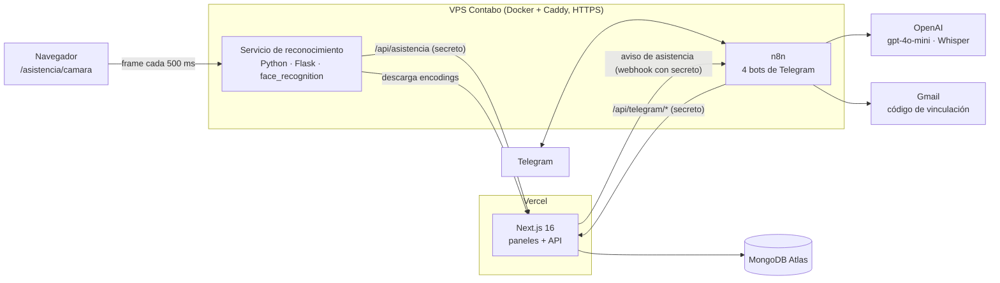

# Sistema de Gestión Académica — Colegio Juan Velasco Alvarado

Sistema web de gestión académica para un colegio: paneles de administrador y profesor, registro de notas y asistencia, **asistencia automática por reconocimiento facial** y **cuatro bots de Telegram** (dos de ellos agentes de IA con tool calling) para docentes y apoderados.

**Demo:** https://colegio-juan-velasco.vercel.app/

**English summary:** A school management system built with Next.js 16, React 19, TypeScript and MongoDB Atlas, with role-based dashboards (admin / teacher), Excel and PDF reports, real-time face-recognition attendance served by a Python microservice (Flask + `face_recognition`/dlib) and four Telegram bots orchestrated in n8n — including two AI agents (OpenAI `gpt-4o-mini`) that call the system's API as tools, and a help bot that accepts voice notes transcribed with Whisper. The codebase is organized by domain modules with application/domain/infrastructure layers and covered by Vitest unit tests.

<!-- captura: docs/demo.png -->

## Qué hace

**Panel de administrador**
- Gestión de usuarios, estudiantes, matrículas, secciones, periodos, áreas, cursos, unidades didácticas y asignaciones docentes.
- Consulta de notas y reportes exportables: **notas por curso** (Excel) y **consolidado por sección** (Excel y PDF).

**Panel de profesor**
- Horario, asignaciones, lista de estudiantes, registro de notas y de asistencia, recordatorios y perfil.

**Asistencia por reconocimiento facial**
- Pantalla de cámara (`/asistencia/camara`) que envía un frame cada 500 ms al servicio de reconocimiento.
- Al identificar a un alumno, se registra su asistencia y se avisa automáticamente a su apoderado por Telegram.

**Bots de Telegram (n8n)**

| Bot | Para quién | Qué hace |
|---|---|---|
| Bot Profesores – Consulta de notas | Docentes | **AI Agent** (gpt-4o-mini + memoria) con 4 herramientas: `autenticar`, `buscar_alumno`, `consultar_notas`, `cerrar_sesion`. El docente pregunta en lenguaje natural y el agente decide qué herramienta usar. |
| Bot Manual – Ayuda del sistema | Usuarios del sistema | **AI Agent** que responde dudas sobre cómo usar la plataforma. Acepta **notas de voz**, que se transcriben con **Whisper**. |
| Bot Padres – Vinculación | Apoderados | Vincula la cuenta de Telegram del apoderado con su hijo mediante DNI y un código de verificación enviado por correo (Gmail). |
| Bot Padres – Notificación de asistencia | Apoderados | Recibe el aviso del sistema y notifica al apoderado cuando su hijo es marcado presente. |

## Arquitectura



- El **dashboard** corre en **Vercel** y la base de datos en **MongoDB Atlas**.
- En el **VPS** corren **n8n** y el **servicio Python de reconocimiento facial**, ambos detrás de **Caddy**, que gestiona el HTTPS automático (la cámara del navegador y los webhooks de Telegram exigen HTTPS).
- **Nada del VPS se conecta directamente a MongoDB:** todo pasa por la API de Next.js, protegida con secretos compartidos.

## Decisiones de diseño

- **Arquitectura modular por dominio.** `src/modulos/` tiene 16 módulos (estudiantes, notas, matrículas, asistencia, telegram, etc.), cada uno con capas `dominio`, `aplicacion`, `infraestructura` y `presentacion`. Los casos de uso no dependen de MongoDB: acceden a los datos mediante repositorios, lo que permite probarlos de forma aislada.
- **Reconocimiento facial que prioriza precisión sobre velocidad** (`reconocimiento-facial/matcher.py`). Un error de identidad es peor que tardar un segundo más, así que una coincidencia solo se acepta si cumple tres condiciones:
  1. **Umbral de distancia:** la distancia del mejor candidato debe estar por debajo de la tolerancia (0,5 por defecto).
  2. **Margen de confianza:** el mejor candidato debe superar al segundo por al menos 0,05; si no, el resultado se considera ambiguo y se descarta, para no confundir personas de rasgos parecidos.
  3. **Votación temporal:** de los últimos 4 frames, al menos 3 deben coincidir con la misma persona, para filtrar un frame con mal ángulo o iluminación.
- **Enrolamiento automático:** un proceso revisa periódicamente qué alumnos tienen foto pero no *encoding*, calcula el vector facial de 128 dimensiones y lo sube al backend. El servicio refresca su base de rostros cada minuto.
- **Registro idempotente:** el backend no duplica la asistencia si el alumno ya fue marcado, y el servicio aplica un tiempo de espera tras marcar a alguien para evitar llamadas innecesarias.
- **Agentes con herramientas, no con acceso a la base de datos.** Los agentes de IA solo pueden actuar a través de endpoints acotados de la API (`/api/telegram/*`), que validan la sesión del docente antes de devolver notas.
- **Workflows de n8n versionados sin secretos.** `n8n/sanear-workflows.mjs` toma los exports originales (ignorados por git) y genera versiones limpias en `n8n/workflows/`, donde URLs y secretos se leen de variables de entorno (`$env.X`).

## Seguridad

- Autenticación con **NextAuth v5** y control de acceso por rol (`ADMIN`, `PROFESOR`) en el `middleware`.
- **Bloqueo de cuenta tras 5 intentos fallidos** de inicio de sesión, con reinicio del contador tras un login exitoso (cubierto por tests).
- Contraseñas con hash **bcrypt**.
- Endpoints de integración (`/api/telegram/*`, `/api/asistencia/*`) protegidos con secretos compartidos, comparados con `timingSafeEqual` para evitar ataques de temporización.
- Validación de entradas con **Zod**.
- Secretos solo en variables de entorno (`.env.example` sin valores); nunca en el repositorio.

## Tests

Pruebas unitarias con **Vitest** sobre los casos de uso: creación, edición y eliminación de estudiantes y asignaciones, inicio de sesión con bloqueo por intentos fallidos, y cálculo de notas por curso y consolidados por sección.

```bash
bun run test
```

## Estructura del repo

```
final_proyect/
  src/
    app/                  # rutas de Next.js: /admin, /profesores, /asistencia, /api
    modulos/              # 16 módulos de dominio (dominio/aplicacion/infraestructura/presentacion)
    compartido/           # utilidades, UI y dominio compartido
    config/               # constantes y validación de variables de entorno
  reconocimiento-facial/  # servicio Python (Flask + face_recognition), Dockerfile
  n8n/                    # workflows saneados de los 4 bots + script de saneamiento
  deploy/contabo/         # docker-compose, Caddyfile y script de preparación del VPS
  scripts/                # seeds y migraciones de datos
```

## Stack

**Frontend y backend:** Next.js 16 · React 19 · TypeScript · Tailwind CSS v4 · shadcn/ui · React Hook Form · Zod · NextAuth v5
**Datos:** MongoDB Atlas · Mongoose
**Reconocimiento facial:** Python · Flask · face_recognition (dlib) · NumPy · Pillow · Docker
**Automatización e IA:** n8n · OpenAI gpt-4o-mini · Whisper · Telegram Bot API · Gmail
**Reportes:** ExcelJS · jsPDF
**Infraestructura:** Vercel · VPS Contabo · Docker Compose · Caddy (HTTPS automático)
**Calidad:** Vitest · ESLint · Prettier

## Cómo ejecutarlo en local

1. Clonar el repositorio e instalar dependencias:
   ```bash
   git clone https://github.com/GiancarlosDev-10/final_proyect.git
   cd final_proyect
   bun install
   ```
2. Copiar `.env.example` a `.env.local` y completar las variables (`MONGODB_URI`, `NEXTAUTH_SECRET` y los secretos de integración).
3. Crear el usuario administrador y datos de prueba:
   ```bash
   bun run seed
   bun run seed:escolares
   ```
4. Levantar el servidor de desarrollo:
   ```bash
   bun run dev
   ```

El despliegue del VPS (n8n y el servicio de reconocimiento) está documentado paso a paso en [`deploy/contabo/README.md`](deploy/contabo/README.md).

## Limitaciones y próximos pasos

- El reconocimiento facial depende de la iluminación y del ángulo de la cámara; la votación temporal reduce errores, pero no reemplaza una buena ubicación del equipo.
- Los parámetros de tolerancia y margen están definidos por defecto; el siguiente paso es calibrarlos con un conjunto de prueba de fotos reales del colegio.
- Ampliar los tests a la capa de API y a los flujos de los bots.
